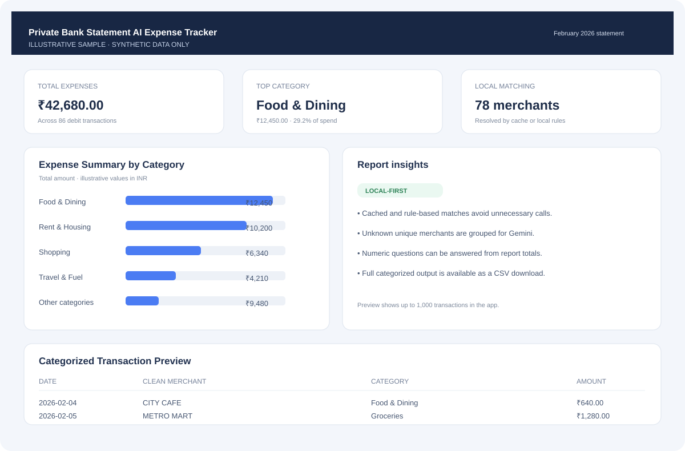
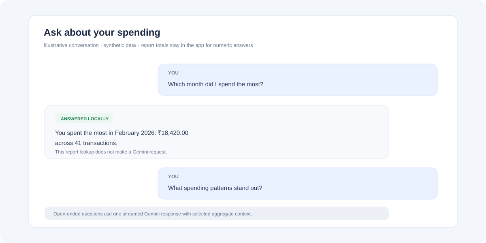
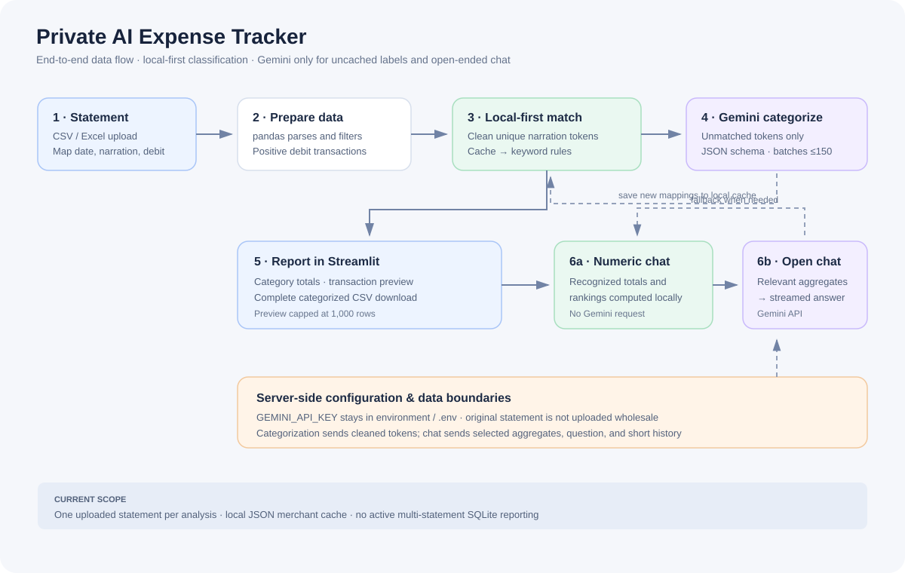

# Private AI Expense Tracker

Turn a bank statement into a categorized spending report, then ask questions
about the results. The app is built with Streamlit, pandas, and Google's Gemini
API. It processes an uploaded statement in the current session and keeps the
Gemini key on the server.

> **Portfolio visuals:** the images below are illustrative mockups generated
> from synthetic transactions. They are not screenshots of a real account or
> live deployment.

## Sample output

<p align="center">
  
</p>

<p align="center">
  
</p>

## End-to-end architecture

<p align="center">
  
</p>

See [docs/architecture.md](docs/architecture.md) for the editable Mermaid
diagram, Gemini API details, data handling notes, and current limitations.

## Features

- Upload CSV or Excel bank statements and map the date, narration, and debit
  columns.
- Categorize unique merchants with local keyword rules and a JSON cache before
  sending uncached merchant tokens to Gemini in batches of up to 150.
- Explore spending by category and preview categorized transactions; download
  the complete result as CSV.
- View a selectable 1–12 month, linear-trend estimate of future spending based
  on the uploaded statement's monthly totals.
- Ask open-ended spending questions using the current statement's full
  aggregate context; the app also answers common report questions and basic
  reduction suggestions locally. Individual transaction records are not sent
  to Gemini.
- Reuse parsed uploads during Streamlit reruns and report basic parsing,
  processing, and Gemini batch timings.

## Run locally

Requires Python 3.10+ and a Gemini API key for AI categorization and open-ended
chat.

```powershell
py -m venv .venv
.\.venv\Scripts\Activate.ps1
python -m pip install -r requirements.txt
Copy-Item .env.example .env
```

Set `GEMINI_API_KEY` in `.env`, then start Streamlit:

```powershell
streamlit run app.py
```

Do not commit `.env` or paste the key into the app UI. A key is required to
start analysis in the current app, including reports that might otherwise only
use local/cache categories.

## Project layout

```text
app.py                  Streamlit UI, categorization, reporting, and chat
expense_forecast.py     Trend-based monthly expense forecasts
merchant_cache.json     Generated local merchant-to-category cache
docs/architecture.md    System flow, API details, and data handling
docs/assets/            Architecture and synthetic sample visuals
tests/                  Unit and Streamlit dashboard tests
requirements.txt        Python dependencies
.env.example            Environment variable template (no real key)
```

## Tests

```powershell
python -m unittest discover -s tests -p "test_*.py"
```

## Current scope

The app analyzes the uploaded statement in the current Streamlit session. The
merchant cache is local; persistent multi-statement SQLite history is not part
of the active dashboard flow. See the architecture notes for additional privacy
and data-scope details. Forecasts use a linear monthly trend, treat months
without recorded expenses as zero, and do not account for seasonality or
guarantee future spending.
