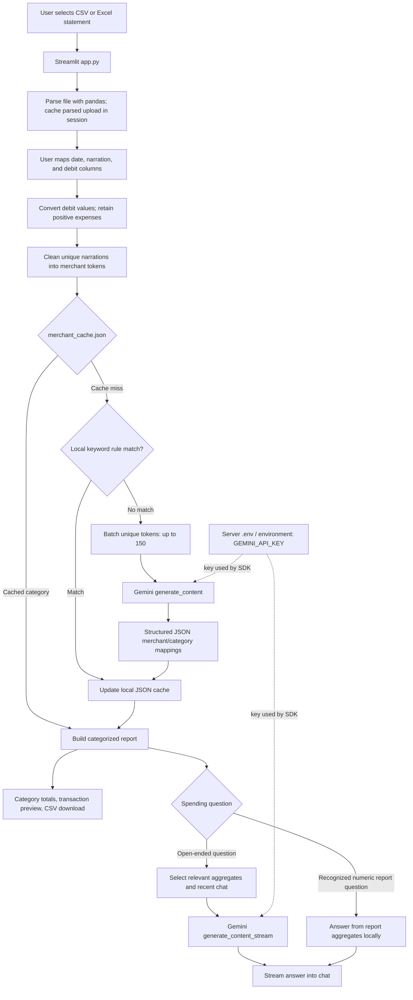

# Architecture and API notes

This document describes the active implementation in the repository:
[`app.py`](../app.py). The system is a single-process Streamlit application;
SQLite persistence and a separate categorizer module are not currently in the
active upload-to-report path.

## End-to-end flow



### Flow details

1. The browser uploads one CSV/XLS/XLSX file. Streamlit caches the parsed
   DataFrame and reuses it during reruns in the same session.
2. The user maps the statement's date, narration, and debit columns. The
   current flow filters positive debits as expenses.
3. Narrations are cleaned once per distinct narration. Merchant category lookup
   checks `merchant_cache.json`, then local keyword rules.
4. Only unique tokens not found in either local source go to Gemini, grouped in
   batches of at most 150. Valid classifications update the local JSON cache.
5. pandas builds category and monthly/merchant aggregates for the report and
   chat context. The app displays up to 1,000 transactions and offers the full
   categorized CSV as a download.
6. Recognized numeric questions (such as overall spend, category totals, or
   highest/lowest month/category) are computed locally. Other questions send a
   selected aggregate context and up to four recent messages to Gemini; tokens
   are streamed back to the UI.

## Gemini API integration

The app uses the official `google-genai` Python SDK with model
`gemini-3.8-flash` (the identifier currently configured in `app.py`). Calls
are made server-side with the Gemini Developer API key. The app does not expose
a separate public REST API of its own and does not manually construct Gemini
HTTP requests.

| Use | SDK call | Input | Output |
|---|---|---|---|
| Categorize unknown merchants | `client.models.generate_content` | Up to 150 cleaned, unique merchant tokens; allowed category list and Indian narration hints | JSON matching `BatchClassification`, with a `merchant_key` and `category` per result |
| Open-ended spending chat | `client.models.generate_content_stream` | Question, selected aggregates, and at most four prior chat messages | Streamed text, capped at 256 output tokens |

Categorization config requests `application/json`, uses the Pydantic
`BatchClassification` response schema, and sets temperature to `0.1`. Chat uses
temperature `0.2`. Typical request/response shapes:

```json
{
  "merchant_tokens": ["LOCAL CAFE", "CITY PHARMACY"],
  "allowed_categories": ["Food & Dining", "Medical & Health", "Other"]
}
```

```json
{
  "results": [
    {"merchant_key": "LOCAL CAFE", "category": "Food & Dining"},
    {"merchant_key": "CITY PHARMACY", "category": "Medical & Health"}
  ]
}
```

The snippets illustrate the logical payload; SDK request configuration also
includes the response schema and prompt instructions. Numeric questions handled
by the local report logic do not make a Gemini request.

### API key setup

Set `GEMINI_API_KEY` in the server process environment or a local `.env` file.
Use `.env.example` as a template. Never commit a real key. The key is read by
the server-side Python app and is not included in report data or browser UI.

## Data handling and privacy

- Original uploaded statements are parsed by the app; the app does not upload
  the file as a whole to Gemini.
- Categorization can send cleaned merchant tokens for cache misses. For UPI
  narrations, the current cleaner may retain the payee and VPA in that token;
  inspect or further redact data if that is not acceptable for your use case.
- Chat sends selected aggregate totals, cleaned merchant labels when relevant,
  the user's question, and a short conversation history. It does not send the
  raw transaction table or original narration column as chat context.
- `merchant_cache.json` is local and can contain merchant strings and
  categories. Treat it as potentially sensitive local data.
- The current report and chat context live in Streamlit session state. The
  active dashboard does not persist statement history to SQLite.

## Current limitations

- One uploaded statement is analyzed at a time; multi-month history requires
  uploading a statement that includes those months.
- Currency is not inferred or normalized. Totals remain in the statement's
  currency.
- The local question matcher covers common numerical questions, not arbitrary
  natural-language analysis; unmatched questions go to Gemini.
- Gemini latency and availability depend on the configured model and service.
- The dashboard currently requires `GEMINI_API_KEY` before analysis even when
  all merchants could be resolved by local rules/cache.

## Local verification

```powershell
python -m unittest discover -s tests -p "test_*.py"
```
